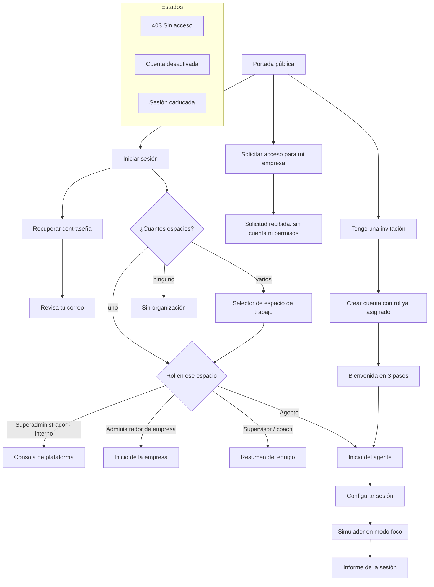
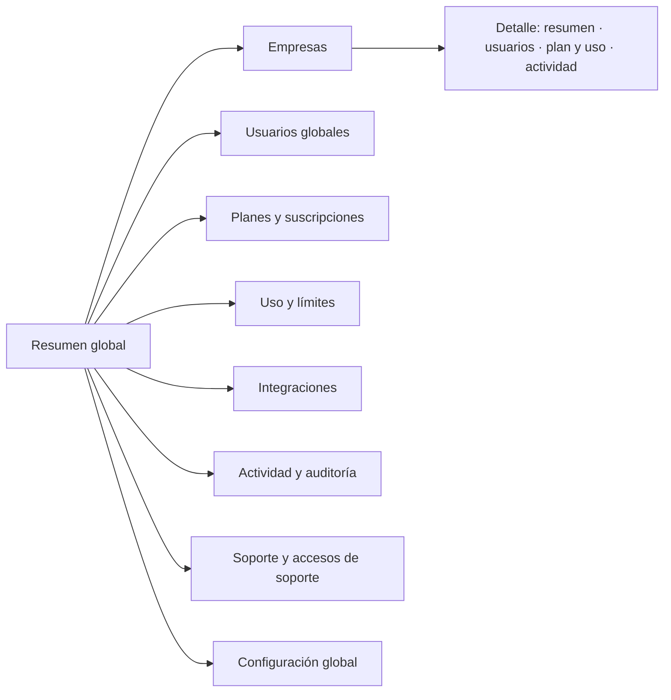
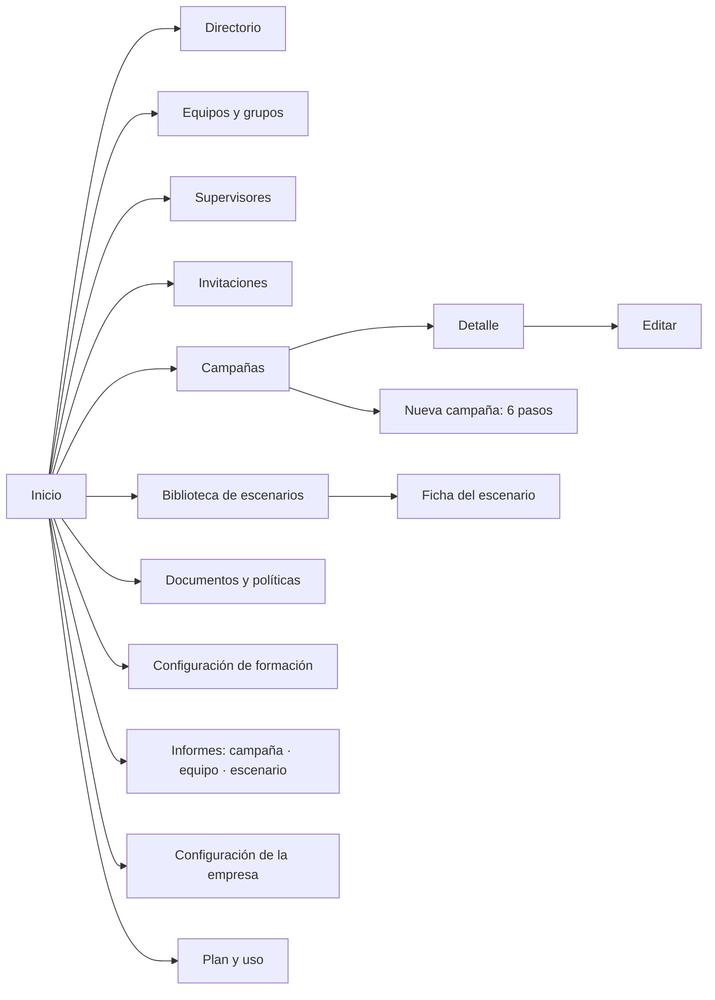
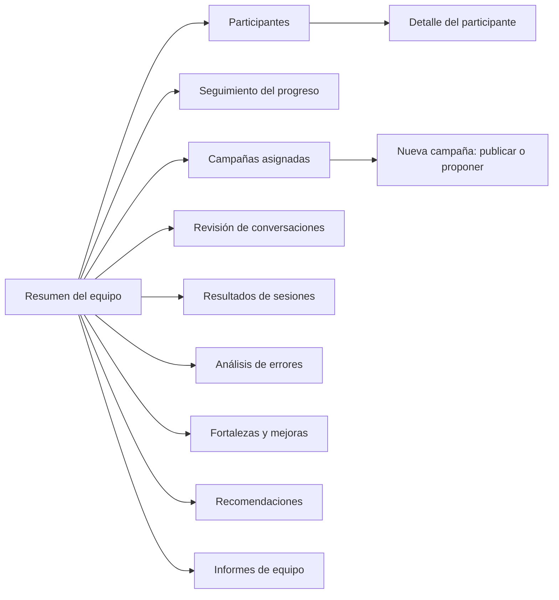
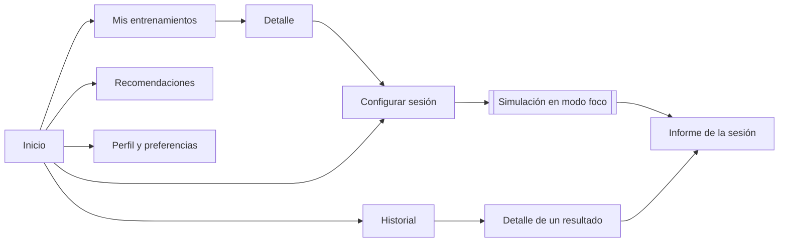

# 1. Navegación y pantallas

## 1.1 Principios de la arquitectura de información

1. **Cada persona entra a un espacio de trabajo** (una empresa) y ve solo lo que su rol permite en ese espacio. Si pertenece a varias empresas, cambia de espacio desde la barra superior; nunca se mezclan datos de dos empresas en la misma pantalla.
2. **La navegación lateral se agrupa por tarea**, no por tipo de dato: *Personas*, *Formación*, *Resultados*, *Organización*. Cada rol tiene entre 7 y 11 destinos, nunca más de 5 grupos.
3. **El simulador se abre en modo foco**, fuera del armazón de la plataforma (sin barra lateral ni superior), porque ocupa toda la pantalla y en el móvil se gira a horizontal.
4. **El rol no se elige**: lo asigna la organización. La interfaz oculta lo que no corresponde, pero el servidor valida cada permiso (ver [Roles y permisos](02-roles-y-permisos.md)).
5. **Las rutas son predecibles**: `/{espacio}/{sección}/{id}/{pestaña}`. En el prototipo se simulan con el *hash*: `#/app/<rol>/<página>/<id>/<pestaña>`.

## 1.2 Mapa de navegación

### Superadministrador (consola privada de la plataforma)

### Administrador de empresa

### Supervisor / coach

### Agente

## 1.3 Armazón común (todas las pantallas con sesión iniciada)

| Zona | Contenido | Notas |
|---|---|---|
| Barra lateral | Marca, grupos de navegación del rol, pie con contexto (plan, equipo o campaña) | En pantallas de menos de 900 px se convierte en un cajón con botón de menú (`aria-expanded`) |
| Barra superior | Selector de espacio de trabajo, búsqueda limitada al espacio, ayuda, notificaciones, menú de usuario | El selector solo se despliega si la persona tiene más de un espacio |
| Migas de pan | En pantallas de detalle y asistentes | — |
| Cabecera de página | Título, etiquetas de estado, descripción y acciones principales | Máximo una acción primaria por página |
| Contenido | Tarjetas, tablas, gráficos | Ancho máximo 1240 px |

Atajos del armazón: `/` enfoca la búsqueda, `Esc` cierra menús, cajón y diálogos, y un enlace «Saltar al contenido» lleva al contenido principal.

## 1.4 Inventario de pantallas

Leyenda de fase: **MVP** = primera versión; **F2** = segunda fase; **Futuro** = después, o depende de decisiones de negocio y proveedores. La ruta es la del prototipo.

### Acceso y estados de cuenta (sin barra lateral)

| Pantalla | Ruta | Propósito | Acciones clave | Fase |
|---|---|---|---|---|
| Portada | `#/access/landing` | Elegir cómo entrar, sin elegir rol | Iniciar sesión · Tengo una invitación · Solicitar acceso | MVP |
| Iniciar sesión | `#/access/login` | Correo y contraseña | Entrar · Recuperar contraseña · SSO (desactivado) | MVP (SSO Futuro) |
| Recuperar contraseña | `#/access/recover` | Pedir un enlace | Enviar enlace | MVP |
| Enlace enviado | `#/access/recover-sent` | Confirmación que no revela si el correo existe | Volver | MVP |
| Solicitar acceso | `#/access/request` | Una empresa pide ser cliente; no crea cuenta | Enviar solicitud | MVP |
| Solicitud recibida | `#/access/request-sent` | Confirmación | Volver | MVP |
| Invitación | `#/access/invite` | Ver empresa, rol asignado (solo lectura) y equipo | Aceptar · Rechazar | MVP |
| Crear cuenta desde invitación | `#/access/invite-account` | Nombre y contraseña; correo bloqueado | Crear cuenta y unirme | MVP |
| Bienvenida | `#/access/onboarding` | Tres pasos: perfil, preferencias, primer entrenamiento | Ir a mi inicio | MVP |
| Selector de espacio | `#/access/workspaces` | Elegir empresa cuando hay varias | Entrar a un espacio | MVP |
| Sin organización | `#/access/no-org` | Cuenta válida sin empresa | Ver invitaciones · Solicitar acceso | MVP |
| Sin acceso (403) | `#/access/denied` | Permiso insuficiente | Volver · Solicitar acceso | MVP |
| Cuenta desactivada | `#/access/disabled` | Acceso retirado por la empresa | Contactar administrador | MVP |
| Sesión caducada | `#/access/expired` | Cierre por inactividad | Volver a entrar | MVP |

### Superadministrador

| Pantalla | Ruta | Propósito | Acciones clave | Fase |
|---|---|---|---|---|
| Resumen global | `#/app/superadmin/overview` | Estado de todas las empresas | Nueva empresa | MVP (básico) |
| Empresas | `…/companies` | Listado con plan, estado y puestos | Filtrar · Nueva empresa · Exportar (Futuro) | MVP |
| Detalle de empresa | `…/companies/bahia[/users\|plan\|activity]` | Datos, usuarios, plan y actividad | Acceso de soporte · Suspender/Reactivar · Cambiar plan | MVP |
| Usuarios | `…/users` | Búsqueda global de cuentas | Filtrar | MVP |
| Planes y suscripciones | `…/plans` | Límites por plan, sin precios | — | MVP (límites) |
| Uso y límites | `…/usage` | Consumo frente al plan | — | F2 |
| Integraciones | `…/integrations` | Servicios externos (ninguno activo) | Configurar (desactivado) | Futuro |
| Actividad y auditoría | `…/audit` | Registro inmutable de acciones | Filtrar · Exportar (Futuro) | MVP |
| Soporte | `…/support` | Tickets y política de acceso de soporte | Solicitar acceso de soporte | MVP (acceso) · F2 (tickets) |
| Configuración global | `…/settings` | Seguridad, retención, biblioteca estándar, idiomas | Guardar | MVP (parcial) |

### Administrador de empresa

| Pantalla | Ruta | Propósito | Acciones clave | Fase |
|---|---|---|---|---|
| Inicio | `#/app/admin/home` | Resumen y tareas sugeridas | Invitar · Nueva campaña | MVP |
| Directorio | `…/directory` | Personas, rol, equipo y estado | Filtrar · Invitar · Cambiar rol · Desactivar · Importar CSV (Futuro) | MVP |
| Equipos y grupos | `…/teams` | Equipos, su coach y miembros | Nuevo equipo · Gestionar | MVP |
| Supervisores | `…/supervisors` | Qué supervisa cada coach y qué puede hacer | — | MVP |
| Invitaciones | `…/invitations` | Pendientes, caducadas y aceptadas | Nueva · Reenviar · Revocar | MVP |
| Campañas | `…/campaigns` | Planes de formación | Filtrar · Nueva campaña | MVP |
| Detalle de campaña | `…/campaigns/c1` | Progreso y configuración | Editar · Duplicar | MVP |
| Asistente de campaña | `…/campaigns/new?step=0…5` | Información, participantes, contenido, evaluación, fechas e informes, revisión | Guardar borrador · Publicar | MVP |
| Biblioteca de escenarios | `…/scenarios` | Los 25 casos reales con filtros | Ver ficha · Nuevo escenario (Futuro) | MVP (lectura) |
| Ficha de escenario | `…/scenarios/d1-daniel` | Inicio de la conversación, ficha, políticas | Usar en una campaña · Editar (Futuro) | MVP |
| Documentos y políticas | `…/documents` | Las 19 políticas por categoría; documentos propios | Subir documento (Futuro) | MVP (lectura) · Futuro (subida) |
| Configuración de formación | `…/training` | Dificultad y ritmo por defecto, reglas | Guardar | MVP |
| Informes | `…/reports[/team\|scenario]` | Por campaña, equipo y escenario | Exportar (Futuro) | MVP (campaña, equipo) · F2 (escenario) |
| Configuración de la empresa | `…/org` | Datos, seguridad, roles, zona sensible | Guardar · Transferir propiedad | MVP (SSO/SCIM Futuro) |
| Plan y uso | `…/plan` | Qué incluye el plan y cuánto se usa | — | MVP (lectura) |

### Supervisor / coach

| Pantalla | Ruta | Propósito | Acciones clave | Fase |
|---|---|---|---|---|
| Resumen del equipo | `#/app/coach/team` | Indicadores, tendencia y atención prioritaria | Abrir participante | MVP |
| Participantes | `…/participants` | Progreso por persona | Filtrar · Invitar agentes a su equipo | MVP |
| Detalle del participante | `…/participants/a3` | Evolución y notas de coaching | Ver conversación · Asignar práctica · Guardar nota | MVP |
| Seguimiento del progreso | `…/progress` | Matriz persona × día con nota y color | — | MVP |
| Campañas asignadas | `…/campaigns` | Campañas del equipo | Nueva campaña · Editar las suyas | MVP |
| Asistente de campaña (coach) | `…/campaigns/new?step=0…5` | El mismo asistente del administrador, limitado a sus equipos | Publicar para mi equipo · Enviar propuesta (si incluye otros equipos) | MVP |
| Revisión de conversaciones | `…/review` | Transcripción con la nota de cada respuesta | Añadir nota de coaching | MVP |
| Resultados de sesiones | `…/results` | Sesiones completadas del equipo | — | MVP |
| Análisis de errores | `…/errors` | Respuestas incorrectas más elegidas | — | F2 |
| Fortalezas y mejoras | `…/strengths` | Mismas reglas del informe de sesión, a nivel de equipo | — | F2 |
| Recomendaciones | `…/coaching` | Sugerencias por reglas (sin IA) | Asignar práctica | F2 |
| Informes de equipo | `…/reports[/team\|scenario]` | Igual que el administrador, limitado al equipo | Exportar (Futuro) | MVP |

### Agente

| Pantalla | Ruta | Propósito | Acciones clave | Fase |
|---|---|---|---|---|
| Inicio | `#/app/agent/home` | Próxima tarea, evolución y recomendaciones | Continuar | MVP |
| Mis entrenamientos | `…/trainings` | Campañas asignadas y práctica libre | Abrir · Practicar | MVP |
| Detalle del entrenamiento | `…/trainings/c1` | Días, reglas y fecha límite | Configurar sesión | MVP |
| Configurar sesión | `…/setup[?source=free]` | Días, dificultad y ritmo (fijados por la campaña o libres en práctica) | Empezar | MVP |
| Simulación | `…/simulation` | Lanzador del simulador en modo foco | Abrir el simulador | MVP |
| Informe de la sesión | `…/report` | El informe que ya genera `session.js` | — | MVP |
| Historial | `…/history` | Todas las sesiones | Ver detalle | MVP |
| Detalle de un resultado | `…/history/h4` | Indicadores y respuesta para repasar | Ver informe completo | MVP |
| Recomendaciones | `…/recommendations` | Políticas a repasar según resultados (sin IA) | Practicar estos casos | MVP |
| Perfil y preferencias | `…/profile` | Datos, preferencias, seguridad y privacidad | Guardar · Cambiar contraseña | MVP |

## 1.5 Panel de cada rol

### Superadministrador · «Consola de plataforma»
- **Para qué:** operar ShiftReady como negocio: dar de alta empresas, vigilar el uso, atender soporte y auditar.
- **Inicio:** empresas activas, usuarios, sesiones de 30 días, cuentas que requieren atención, uso de puestos por empresa y actividad administrativa reciente.
- **Grupos de navegación:** Plataforma (Resumen, Empresas, Usuarios) · Comercial (Planes, Uso) · Operación (Integraciones, Soporte) · Gobierno (Auditoría, Configuración global).
- **Particularidades:** el pie de la barra lateral recuerda que es un acceso privado y auditado. Para entrar en el espacio de una empresa usa el **acceso de soporte** (motivo, duración limitada, aprobación de la empresa si hay datos personales, registro en auditoría). No ve conversaciones de agentes por defecto.

### Administrador de empresa · «Inicio de la empresa»
- **Para qué:** organizar personas y equipos, diseñar campañas de formación y leer resultados.
- **Inicio:** personas activas frente a puestos, campañas activas, sesiones del mes, puntuación media, campañas en curso y tareas sugeridas (equipos sin coach, invitaciones caducadas, puestos casi agotados).
- **Grupos:** General · Personas (Directorio, Equipos, Supervisores, Invitaciones) · Formación (Campañas, Escenarios, Documentos, Configuración de formación) · Resultados (Informes) · Organización (Empresa, Plan y uso).
- **Particularidades:** el pie muestra el plan y los puestos usados. Puede pertenecer a varias empresas (en el prototipo, Laura también es coach en Andes BPO).

### Supervisor / coach · «Resumen del equipo»
- **Para qué:** seguir a las personas de sus equipos y ayudarlas a mejorar.
- **Inicio:** participantes, puntuación media con tendencia, calidad de respuestas, quién necesita apoyo y la evolución semanal frente a la nota de aprobado.
- **Grupos:** General · Equipo (Participantes, Progreso) · Formación (Campañas asignadas, Revisión de conversaciones) · Análisis (Resultados, Errores, Fortalezas, Recomendaciones, Informes).
- **Particularidades:** todo se limita a sus equipos. Puede invitar agentes a sus equipos y crear y publicar campañas para ellos; una campaña que incluya otros equipos se envía como propuesta a un administrador.

### Agente · «Inicio»
- **Para qué:** saber qué tiene que entrenar, entrenar y ver cómo mejora.
- **Inicio:** una tarjeta destacada con la próxima tarea (campaña, día pendiente, fecha límite y botón Continuar), indicadores personales, evolución y recomendaciones.
- **Grupos:** General · Entrenar (Mis entrenamientos, Nueva sesión) · Resultados (Historial, Recomendaciones) · Cuenta (Perfil).
- **Particularidades:** la simulación se abre en modo foco. Solo ve sus propios resultados; sus compañeros no.
