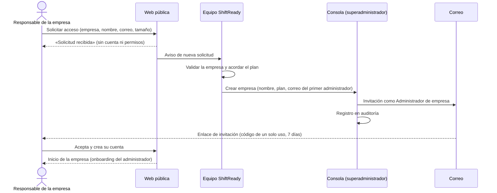
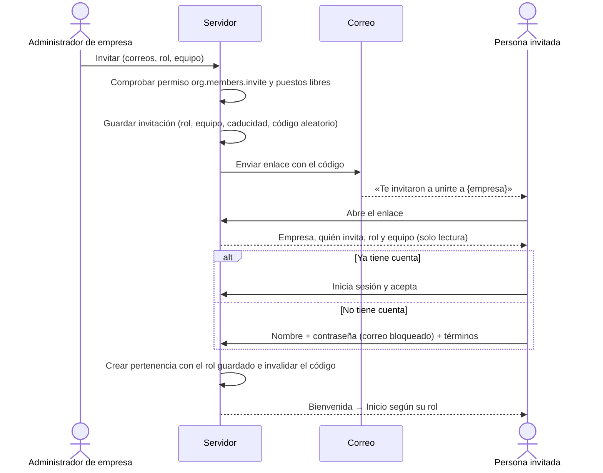
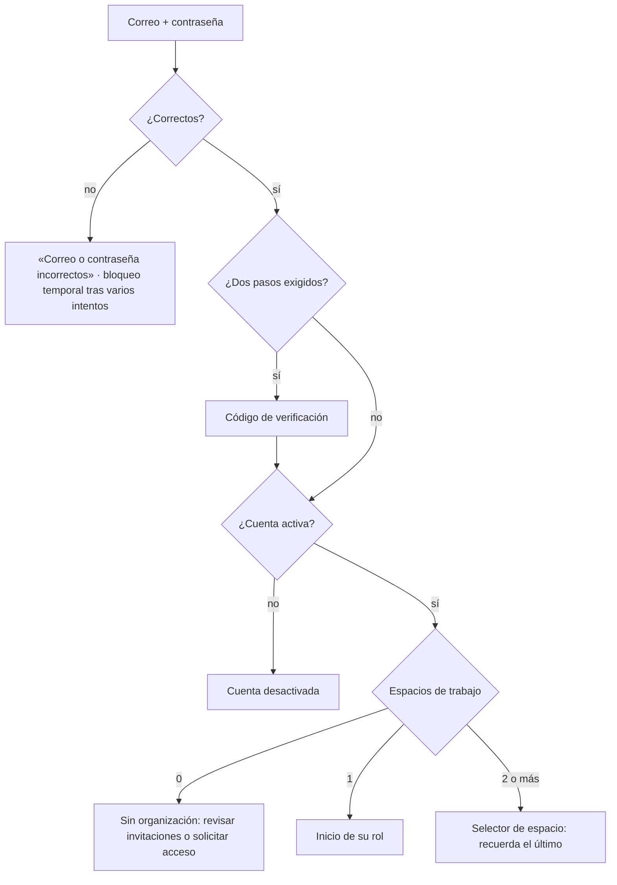
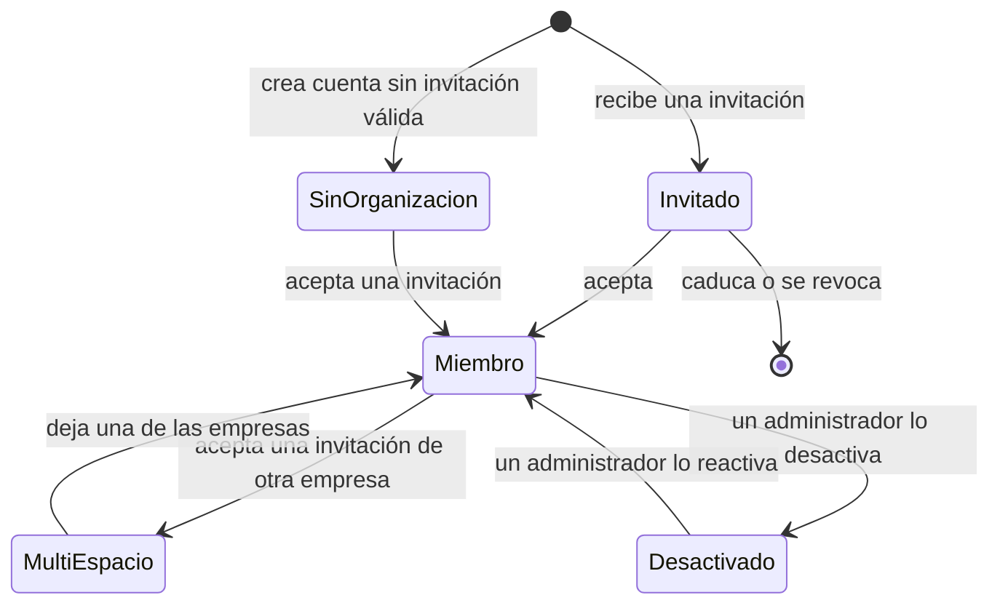

# 3. Acceso, registro e invitaciones

## 3.1 Idea central

**Nadie consigue permisos rellenando un formulario.** Hay tres puertas y ninguna permite elegir rol:

| Puerta | Para quién | Qué crea |
|---|---|---|
| **Iniciar sesión** | Personas con cuenta | Nada nuevo |
| **Tengo una invitación** | Agentes, coaches y administradores invitados por su empresa | Una cuenta (si no la tenía) y su pertenencia a la empresa **con el rol que fijó quien invitó** |
| **Solicitar acceso para mi empresa** | Empresas que aún no son clientes | Solo una solicitud para el equipo de ShiftReady. **No crea cuenta ni permisos** |

El superadministrador no tiene puerta pública: se asigna por un procedimiento interno (3.6).

## 3.2 Alta de una empresa (propuesta: gestionada por ShiftReady)

> **Decidido:** el alta la gestiona ShiftReady. Si en el futuro se añade autoservicio, quien cree una empresa solo obtendrá el rol de administrador **de esa empresa nueva y vacía**, nunca acceso a otras empresas ni a la consola.

## 3.3 Invitación de una persona

**Pantallas del prototipo:** `#/access/invite` → `#/access/invite-account` → `#/access/onboarding`.

Un **coach** sigue el mismo flujo con dos límites que comprueba el servidor: solo puede invitar con el rol Agente y solo a los equipos que supervisa (`#/app/coach/participants` → «Invitar agentes»).

### Casos límite

| Situación | Qué ve la persona |
|---|---|
| La invitación caducó | «Esta invitación caducó. Pide a {quien invitó} que te envíe otra.» |
| La invitación fue revocada | Mismo mensaje que caducada (no revela el motivo) |
| Ya es miembro de la empresa | Se le lleva a esa empresa sin crear otra pertenencia |
| Ha iniciado sesión con otro correo | «Esta invitación es para j•••@bahia.demo. Cierra sesión y entra con ese correo.» |
| La empresa no tiene puestos libres al aceptar | «Tu empresa alcanzó su límite de puestos. Avisamos a su administrador.» (y se le notifica) |
| Su cuenta está desactivada en esa empresa | Pantalla «Cuenta desactivada»; puede seguir usando otras empresas |

## 3.4 Inicio de sesión y selección de espacio

- El mensaje de error **no distingue** entre correo inexistente y contraseña incorrecta.
- «Recuperar contraseña» siempre responde «Si existe una cuenta con ese correo, recibirás un enlace» (`#/access/recover-sent`).
- La **sesión caduca** tras un tiempo sin actividad (30 minutos propuestos). Una simulación en curso se pausa y se retoma al volver (`#/access/expired`).
- El acceso con **SSO** de la empresa aparece como «Próximamente» y desactivado.

## 3.5 Estados de una persona

En la interfaz cada estado tiene una **insignia con icono y texto** (nunca solo color):

| Insignia | Significado | Dónde aparece |
|---|---|---|
| Sin organización | Cuenta válida sin empresa | Pantalla «Sin organización» |
| Invitado | Invitación pendiente de aceptar | Invitación, directorio, invitaciones |
| Miembro | Pertenece a una empresa | Bienvenida, directorio |
| Multi-espacio | Pertenece a varias empresas | Selector de espacio y menú de usuario |
| Desactivado | Acceso retirado por la empresa | Directorio (para administradores) |

## 3.6 Procedimiento para asignar un superadministrador

1. Una persona del equipo interno de ShiftReady lo solicita por escrito indicando motivo y duración (si es temporal).
2. **Dos** responsables distintos lo aprueban; ninguno puede ser la persona solicitante.
3. La persona debe tener activada la verificación en dos pasos (preferiblemente con llave física).
4. El rol se asigna con una herramienta interna o un script auditado, **no** desde la interfaz pública ni desde la consola de empresa.
5. Se avisa a todos los superadministradores y queda en la auditoría de plataforma.
6. Cada trimestre se revisa la lista y se retiran los accesos que ya no hacen falta.

El selector de espacio solo muestra la «Consola de plataforma» a las cuentas que tienen ese rol (en el prototipo aparece con borde discontinuo y un candado para indicarlo).

## 3.7 Textos de las pantallas de acceso (guía)

- Hablar de **«tu organización»** como la fuente del rol: «Tu rol lo asigna tu organización».
- Explicar el siguiente paso siempre: quién puede ayudar y qué hacer.
- No revelar si una cuenta existe, ni el motivo de una revocación.
- Mostrar el correo invitado parcialmente oculto cuando la persona ha iniciado sesión con otro.
